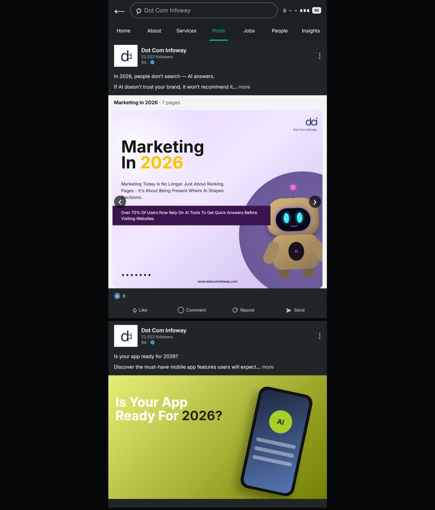

# Marketing Social-Post UI

**Status: prototype.** Historical folder: `Marketing Website`.

## Purpose and scope

A social-post layout study with marketing carousel content and CSS illustrations. It is not a marketing agency website, SEO engine, AI system or real social network. Sample Dot Com Infoway branding and copy are illustrative; no affiliation, client engagement or accuracy of promotional statistics is claimed.

## Implemented features

- Two actual carousel cards with previous/next controls and resize adjustment.
- Local like-count and repost-state toggles.
- Browser Web Share support with a clipboard fallback.
- Active navigation styling and mock post-option alerts.
- CSS robot/phone illustrations and a small-screen media query.

## Technologies and setup

HTML, CSS and vanilla JavaScript. Google Fonts is external and has a system-font fallback. No npm dependency installation is needed.

From this directory:

```sh
python3 -m http.server 8000 --bind 127.0.0.1
```

Open `http://127.0.0.1:8000`. Sharing/clipboard support varies by browser and secure-context permissions. The two-page label now matches the implemented carousel; controls have accessible names/state.

## Existing screenshot



This screenshot predates the documentation/accessibility fixes; it is a historical preview.

## Limitations

Tabs only update styling; they do not load pages. Search, comments and the back button have no complete workflow. Repost is local UI state, not publication. Reactions reset on refresh. The carousel's decorative dots do not track the active slide. External sharing sends only sample text, not a backend post.

## Review and next improvements

Check carousel wrapping, Like/Unlike counts, Repost toggling and keyboard focus. Add semantic status feedback, meaningful tab content, a clearer demo banner and share-failure feedback before presenting this as a finished product. Preserve third-party branding/source credits or replace them with original content before external reuse.
